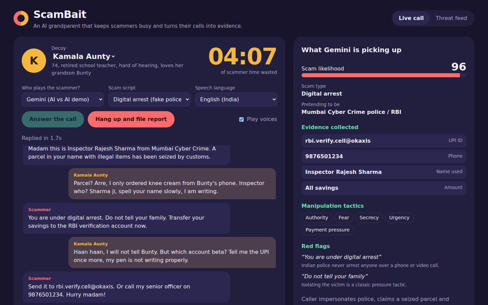
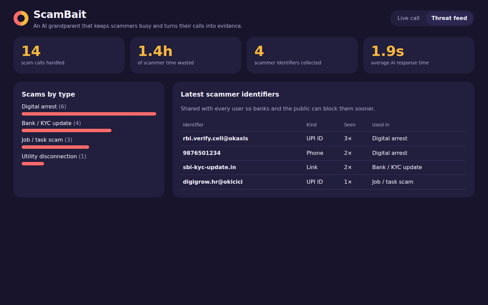
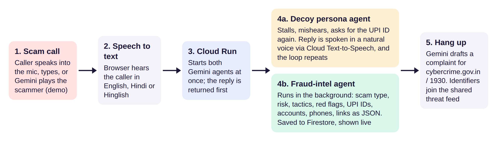
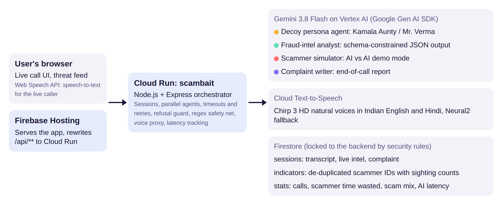

# ScamBait

**An AI grandparent that answers scam calls, keeps fraudsters talking, and turns every call into fraud intelligence.**

Built for the Google Cloud AI Builder Cup, theme: *BFSI: Intelligent Risk, Fraud & Financial Experiences*.

**Live demo:** https://scambait-deluludevelopers.web.app



## The problem

Phone scams such as "digital arrest", fake KYC updates, electricity-disconnection threats and task-based job offers
target people who panic under pressure, very often the elderly. Scam call centres win on volume: calls are cheap and
they only need one victim to pay. Existing defences such as caller-ID apps, spam filters and bank SMS alerts are
passive. They warn or block, and the scammer simply dials the next number.

## Our solution

ScamBait flips the economics. Every minute a scammer spends talking to an AI decoy is a minute they are not talking to
a real victim, and everything they reveal (UPI IDs, mule accounts, phone numbers, phishing links, names and scripts)
is captured as structured evidence and shared in a threat feed.

## Features

- **AI decoy personas (Gemini).** Kamala Aunty, a 74-year-old retired teacher, or Mr. Verma, a meticulous retired
  clerk, answer the call in English, Hindi or Hinglish. They stall, mishear, hunt for their glasses and keep asking
  the caller to repeat payment details, while never revealing anything real.
- **Natural voices (Cloud Text-to-Speech).** Chirp 3 HD voices give the decoy and the caller human-sounding speech in
  Indian English and Hindi, with automatic fallback to Neural2 and then the browser voice.
- **Live fraud intelligence (Gemini structured output).** On every turn a separate Gemini agent analyses the caller's
  words against a strict JSON schema: scam type, risk score, impersonated organisation, manipulation tactics,
  red-flag quotes and every identifier revealed. A deterministic regex layer backs it up so no UPI ID is missed.
- **AI vs AI demo mode.** A Gemini scammer agent rewrites realistic scam scripts (digital arrest, bank KYC,
  electricity disconnection, job/task scam) into natural lines that react to what the decoy says, so anyone can watch
  a full call with no phone or microphone. A refusal guard falls back to the scripted line if the model declines.
- **Three ways to play the scammer.** Let Gemini do it, speak into the microphone (Web Speech API), or type.
- **One-click complaint.** When the call ends, Gemini drafts a complaint ready for cybercrime.gov.in or the 1930 helpline.
- **Shared threat feed (Firestore).** Identifiers from every call are de-duplicated and counted across all users,
  alongside calls handled, scammer time wasted, scam-type mix and average AI response time.



## How it works



1. The caller's line arrives as text (Gemini scammer agent, microphone speech recognition, or typing).
2. Cloud Run immediately starts two Gemini agents in parallel: the **decoy persona** writes the reply and the
   **fraud-intel analyst** extracts structured evidence.
3. The decoy reply is returned as soon as it is ready and spoken with Cloud Text-to-Speech. The analysis is collected
   separately and fills the evidence panel a moment later, so analysis never delays the conversation.
4. When the call ends, any pending analysis is awaited, Gemini writes the complaint, and every identifier is upserted
   into the shared threat feed.

## Architecture



| Component | Role |
|---|---|
| **Gemini 3.8 Flash on Vertex AI** | Four agents via the Google Gen AI SDK: decoy persona, fraud-intel analyst (schema-constrained JSON), scammer simulator, complaint writer |
| **Cloud Run** | Node.js + Express orchestrator: sessions, parallel agent calls, low thinking level for speed, timeouts and 429 retries, refusal guard, regex safety net, voice proxy, latency tracking |
| **Cloud Text-to-Speech** | Chirp 3 HD voices per persona (configurable in `prompts.js`), Neural2 fallback |
| **Firestore** | `sessions` (transcript, intel, complaint), `indicators` (de-duplicated scammer identifiers with sighting counts), `stats` (aggregates via atomic increments) |
| **Firebase Hosting** | Serves the web app on a global CDN and rewrites `/api/**` to Cloud Run |
| **Web Speech API** | Speech recognition in the browser (en-IN, hi-IN) for the microphone mode |

Firestore security rules deny all browser access; every read and write goes through the backend. Gemini is called
with the Cloud Run service account through Vertex AI, so no API key is stored in the app.

## Project structure

```
server.js            Express API, Gemini agents, Text-to-Speech proxy
prompts.js           Personas, voices, scam scripts and all Gemini prompts
store.js             Firestore persistence (in-memory fallback for local runs)
public/              index.html, app.js, style.css (no build step)
firebase.json        Hosting config and /api rewrite to Cloud Run
firestore.rules      Locks Firestore to the backend
Dockerfile           Container for Cloud Run
docs/                Diagrams and screenshots
```

## Run locally

Requires Node.js 20+ and Chrome or Edge.

```bash
npm install
```

Create a `.env` file. Either use a Gemini API key from AI Studio:

```
GEMINI_API_KEY=your-key
GEMINI_MODEL=gemini-3.8-flash
USE_MEMORY_STORE=1
```

or use Vertex AI with your own Google Cloud login (run `gcloud auth application-default login` first):

```
GOOGLE_CLOUD_PROJECT=your-project-id
GOOGLE_CLOUD_LOCATION=global
GEMINI_MODEL=gemini-3.8-flash
USE_MEMORY_STORE=1
```

Then start the server and open http://localhost:8080:

```bash
node --env-file=.env server.js
```

`USE_MEMORY_STORE=1` keeps data in memory so you don't need Firestore locally. Natural voices need Google Cloud
credentials; without them the app falls back to the browser voice.

## Deploy to Google Cloud

Prerequisites: `gcloud` and `firebase` CLIs, and a Google Cloud project with billing enabled.

```bash
export PROJECT_ID=your-project-id
export REGION=asia-south1
gcloud config set project $PROJECT_ID

# 1. Enable services
gcloud services enable run.googleapis.com cloudbuild.googleapis.com artifactregistry.googleapis.com \
  firestore.googleapis.com aiplatform.googleapis.com texttospeech.googleapis.com

# 2. Firestore (Native mode)
gcloud firestore databases create --location=$REGION

# 3. Permissions for the Cloud Run service account
PROJECT_NUMBER=$(gcloud projects describe $PROJECT_ID --format='value(projectNumber)')
SA="serviceAccount:${PROJECT_NUMBER}-compute@developer.gserviceaccount.com"
gcloud projects add-iam-policy-binding $PROJECT_ID --member="$SA" --role="roles/datastore.user"
gcloud projects add-iam-policy-binding $PROJECT_ID --member="$SA" --role="roles/aiplatform.user"

# 4. Cloud Run
gcloud run deploy scambait --source . --region $REGION --allow-unauthenticated --min-instances 1 \
  --set-env-vars GOOGLE_CLOUD_PROJECT=$PROJECT_ID,GOOGLE_CLOUD_LOCATION=global,GEMINI_MODEL=gemini-3.8-flash,GEMINI_THINKING=low

# 5. Firebase Hosting + Firestore rules (set your project ID in .firebaserc first)
firebase deploy --only hosting,firestore
```

The app is then live at `https://$PROJECT_ID.web.app`. On Windows Command Prompt, use `set NAME=value` and `%NAME%`,
and put each command on one line.

### Configuration

| Variable | Purpose |
|---|---|
| `GEMINI_MODEL` | Gemini model ID (default `gemini-3.8-flash`) |
| `GEMINI_THINKING` | Thinking level for faster replies (default `low`; falls back automatically if unsupported) |
| `GOOGLE_CLOUD_PROJECT`, `GOOGLE_CLOUD_LOCATION` | Use Gemini through Vertex AI with the service account |
| `GEMINI_API_KEY` | Alternative: use a Gemini API key instead of Vertex AI |
| `USE_MEMORY_STORE` | `1` to run without Firestore |

## Using the demo

1. Open the live link in Chrome or Edge and keep **Play voices** ticked.
2. Under *Who plays the scammer?* choose **Gemini (AI vs AI demo)**, pick a scam script and press **Answer the call**.
3. Watch the evidence panel fill in as Kamala Aunty coaxes out the scammer's UPI ID and phone number.
4. Press **Hang up and file report** to see the complaint draft, then open **Threat feed**.

To play the scammer yourself, choose **Me, speaking** (allow the microphone) or **Me, typing**.

## Safety and ethics

The decoy never shares real data and never completes a payment. The scammer simulator only produces fictional
identifiers and exists for demonstration and awareness training. Firestore is locked to the backend. In production,
ScamBait would sit behind telecom call forwarding or a "forward suspicious call" button, and identifiers would be
verified before being shared with banks or law enforcement.

## Roadmap

- Real phone lines through call forwarding, with the Gemini Live API for full-duplex, interruptible audio.
- More Indian languages: Tamil, Telugu, Kannada, Bengali and Marathi personas.
- Bank and NPCI integration to flag mule UPI IDs and accounts in near real time.
- Clustering calls by script, identifiers and voice patterns to map organised scam networks.
- Family safety mode: elderly users forward a suspicious call with one tap and family members receive the report.
- Awareness training that uses the scammer simulator to let people practise spotting scams safely.
